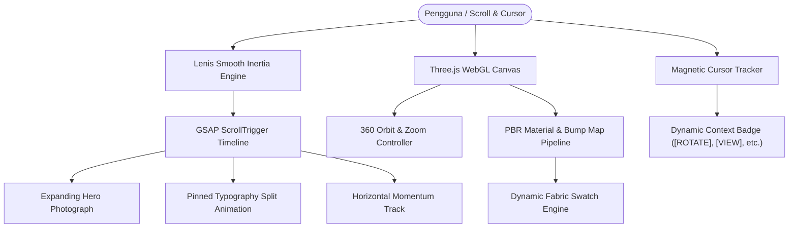

# ⚜️ Evenstar — Maison of Modern Tailoring

[](https://github.com/luminariadev/evenstar/actions/workflows/ci.yml)
[](LICENSE)
[](https://vitejs.dev/)
[](https://threejs.org/)
[](https://greensock.com/)
[](https://lenis.darkroom.engineering/)
[](https://www.docker.com/)

**Evenstar** adalah platform web luxury fashion & modern tailoring atelier interaktif untuk busana pria dan wanita. Dibangun dengan filosofi *quiet luxury*, tipografi editorial haute couture, dan animasi scrolling sinematik berbasis micro-interactions presisi tinggi.

---

## ✨ Fitur & Arsitektur Pengalaman Pengguna

1. **Editorial Preloader & Micro-Interactions**
   - Counter tabular numerik dinamis (`000` → `100`) dengan aksen garis progres gading (*ivory gold*).
   - Efek unmasking tirai via GSAP timeline.
   - Procedural 35mm film grain overlay untuk estetika analog berkelas.

2. **Hero Expanding Frame ScrollTrigger**
   - Header adaptif dengan mode `mix-blend-mode: difference` yang responsif terhadap arah scrolling.
   - Tata letak 3-kolom menampilkan Womenswear (Camel Wool Coat) dan Menswear (Flannel Suit).
   - Frame tengah bertransformasi dinamis mengikuti scroll pengguna menjadi foto hero full-viewport 100% (*The After Hours — Autumn/Winter*).

3. **Haute Couture 3D Interactive Atelier (Three.js WebGL)**
   - Showcase 3D 360° interaktif:
     - `01. Bias Slip Dress` (Women Evening)
     - `02. Double Overcoat` (Men/Unisex)
     - `03. One-Shoulder Gown` (Couture Gown)
     - `04. Sculpted Blazer` (Structured Tailoring)
   - Studio lighting: warm key light, cool rim kicker untuk refleksi sutra/wol, serta plinth marmer travertine.
   - **Katalog Kain PBR Interaktif**: Penggantian jenis kain seketika (*Silk Charmeuse, Duchess Satin, Silk Velvet, Double Cashmere, Wool Flannel, Linen-Silk*) dengan procedural micro-weave bump maps dan data spesifikasi teknis (*reference, fabric origin, weight*).

4. **Product Track & Interactive Wishlist**
   - Horizontal momentum drag & wheel scroll carousel.
   - Filter tab kategori: `All`, `Women`, `Men`.
   - Quick-add size selector (`XS`, `S`, `M`, `L`, `48`, `50`) dengan feedback toast.
   - Wishlist toggle interaktif dengan live badge counter di navbar.

5. **Custom Editorial Magnetic Cursor**
   - Kursor magnetik dengan transisi status dinamis (`[ VIEW ]`, `[ DRAG ]`, `[ ROTATE ]`, `[ WOMEN ]`, `[ MEN ]`).

---

## 🏛️ Arsitektur Interaktivitas



---

## 📁 Struktur Direktori

```text
evenstar/
├── .github/
│   └── workflows/
│       └── ci.yml             # GitHub Actions automated build CI pipeline
├── public/                    # Aset model 3D, tekstur kain, dan font editorial
├── scripts/                   # Utilitas kompresi gambar & tekstur
├── src/
│   ├── components/            # Komponen modular UI & Three.js canvas
│   ├── styles/                # Styling CSS editorial
│   └── main.js                # Entry point aplikasi & inisialisasi animasi
├── .dockerignore              # Rule exclude Docker
├── .gitignore                 # Rule exclude Git
├── Dockerfile                 # Multi-stage production Dockerfile (Vite + Nginx)
├── docker-compose.yml         # Konfigurasi container lokal & server
├── index.html                 # Dokumen HTML utama
├── LICENSE                    # Lisensi MIT
├── nginx.conf                 # Konfigurasi Nginx web server & caching headers
├── package.json               # Manifest dependensi & script
├── vercel.json                # Konfigurasi routing deploy Vercel
└── README.md                  # Dokumentasi proyek
```

---

## 🚀 Panduan Menjalankan

### Opsi 1: Menjalankan Menggunakan Docker (Direkomendasikan)

Prasyarat: Terinstal Docker dan Docker Compose.

```bash
# 1. Clone repository
git clone https://github.com/luminariadev/evenstar.git
cd evenstar

# 2. Jalankan container
docker compose up -d --build

# 3. Buka di browser
# http://localhost:3000
```

---

### Opsi 2: Menjalankan di Lingkungan Lokal (Node.js)

```bash
# 1. Install dependencies
npm install

# 2. Jalankan development server
npm run dev
# Server aktif di http://localhost:5173

# 3. Build untuk produksi
npm run build

# 4. Preview build produksi lokal
npm run preview
```

---

## 🧪 Pipeline CI/CD

Repository ini dilengkapi pipeline otomatis berbasis **GitHub Actions** (`.github/workflows/ci.yml`) yang memvalidasi integritas kode pada setiap *push* atau *pull request*:
- Instalasi dependensi dengan `npm ci`.
- Eksekusi bundling produksi dengan Vite (`npm run build`).
- Validasi sintaks `docker-compose.yml`.

---

## 📄 Lisensi

Didistribusikan di bawah lisensi **MIT**. Silakan lihat file [`LICENSE`](LICENSE) untuk informasi lengkap.

---

## 👤 Pembuat

**luminariadev**  
- GitHub: [@luminariadev](https://github.com/luminariadev)  
- Email: rizkianuari83@gmail.com
